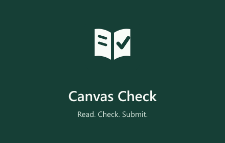
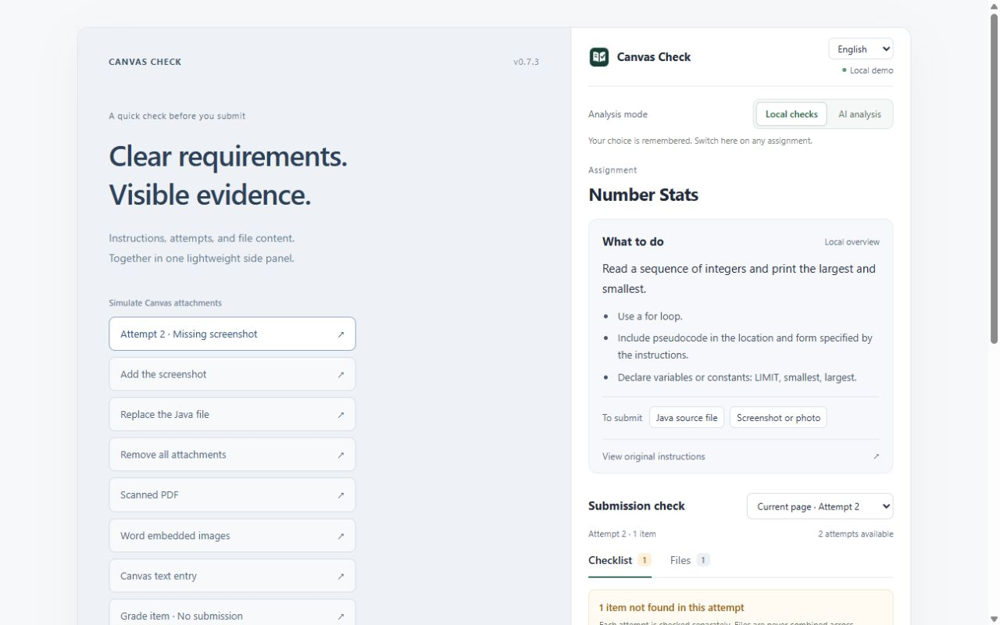
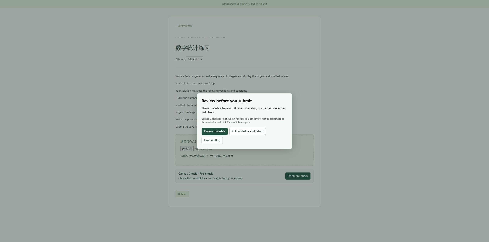
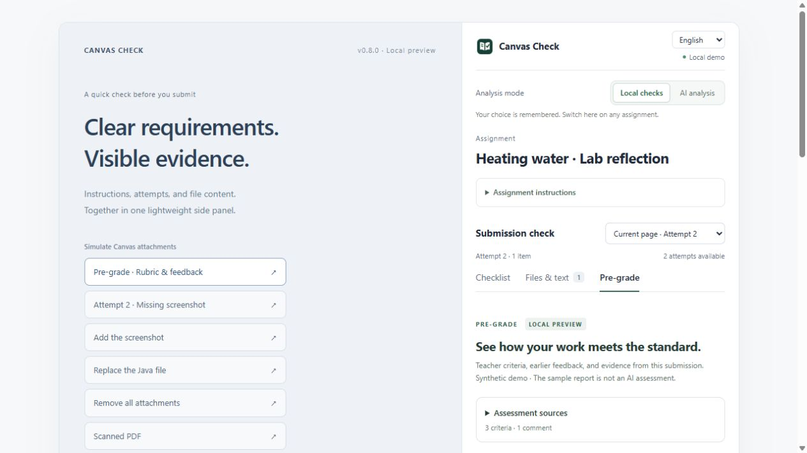
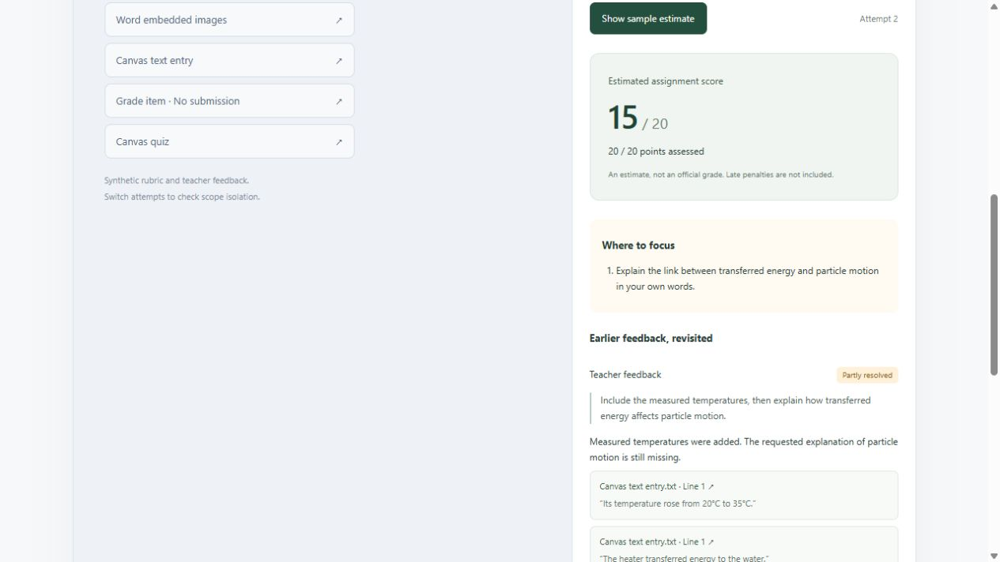

# Canvas Check

**Read. Check. Submit.** A Chrome extension that summarizes Canvas assignments and checks your work **before you submit**.



Built for the Teens Hack Houston productivity theme. Version **0.8.4**, prototype/beta.

## What it does

- Turns assignment instructions into a short overview and submission checklist.
- Automatically reads the files and text already selected in Canvas. No second upload to the extension.
- Checks for missing materials and possible assignment mix-ups while work is still a draft.
- Shows a reminder on supported Canvas Submit controls when a check is incomplete or the draft has changed. Students make the final submission themselves.
- Keeps previous attempts separate and available as explicit reference views.
- Offers optional **Pre-grade**, using readable rubrics, explicit point-based criteria, and eligible earlier teacher feedback on the same assignment.
- Supports English and Simplified Chinese, with local checks and optional AI analysis.

## Try the packaged extension

Download **canvas-check-v0.8.4-chrome.zip** from [the v0.8.4 beta release](https://github.com/7cj-bb/canvas-check/releases/tag/v0.8.4).

1. Extract the ZIP into a folder you will keep.
2. Open `chrome://extensions` in desktop Chrome and turn on **Developer mode**.
3. Choose **Load unpacked** and select the extracted folder containing `manifest.json`.
4. Open a supported Canvas assignment, select files or enter text as usual, then open Canvas Check.
5. Review the checklist before submitting. AI analysis and Pre-grade have their own data-use choices.

The packaged beta connects to the hosted backend; students do not need an OpenAI key or a local server. Shared AI capacity is limited, and local checks remain available when AI is unavailable. This is a manual beta installation, **not a Chrome Web Store listing**.

**Current school support:** `thevillageschool.instructure.com`. Other schools, custom Canvas layouts, and mobile devices are not yet supported or verified. An authenticated account at the supported school is needed for live Canvas use. Judges without an account can use the synthetic demonstration below.

## Run a synthetic demonstration

Requires Node.js **22.12+** and npm.

```sh
npm ci
npm run dev
```

Open `http://127.0.0.1:5173/demo.html`. The demonstration uses synthetic assignments and materials. `/demo.html?scenario=pregrade` shows an illustrative Pre-grade flow. Demonstration scores are not real model evaluations or evidence of grading accuracy. `/smoke.html` contains browser reading checks. No school account is needed for these fixtures.

## Develop and test

```sh
npm test
npm run build
```

The default build writes the unpacked development extension to `dist/` and uses the local AI bridge. It does not include a production credential. Optional local AI: run `npm run ai`, open `http://127.0.0.1:4318/setup`, and configure your own OpenAI key there. Development credentials are written to the ignored `.local-private/` directory, or `CANVAS_CHECK_PRIVATE_DIR` if set.

See [Cloud deployment](docs/DEPLOYMENT.md) to host your own backend and build a cloud-connected extension.

Publication validation: **123 automated tests**, TypeScript checks, and the production build passed. Tests use synthetic materials and do not establish accuracy across all schools or assignments.

## What can be read

| Material | Coverage |
| --- | --- |
| Java and other text/source files | Source text is read; code is never executed. |
| Text, scanned, and mixed PDFs | Text extraction and page images; AI can inspect scanned pages. Up to 20 pages per file. |
| Common images | Browser-decodable images; animated formats use the first frame and are marked partial. |
| DOCX | Text, tables, and supported embedded images. |
| XLSX | Cell values, text, and formulas, within configured sheet/row limits. |
| PPTX | Text and supported embedded images; native slide layout is not rendered, so coverage stays partial. |
| Canvas text entry | Current editor text and supported same-origin embedded images. |

Limits include 10 attachments and 20 MB per reading pass, plus Canvas text. Unsupported, encrypted, oversized, or unreadable material is marked incomplete. Old Office formats, archives, audio, and video are not supported. Reading coverage does not guarantee correct OCR or AI interpretation.

Grade-only items, on-paper work, Canvas quizzes, and external-tool submissions are recognized by their submission mode rather than their title. They do not receive this file-upload checklist. Exams that explicitly require an upload are treated as upload assignments.

## Privacy and limitations

Local checks run in the browser. Optional AI sends assignment instructions and the selected material content to a Cloudflare Worker and OpenAI. Pre-grade separately requests consent for the relevant rubric and earlier feedback. Login cookies, passwords, and signed file URLs are not sent to the model. OpenAI `store:false` is used; it is not a promise of zero provider retention.

OpenAI and Cloudflare credentials are not included in this repository or the extension release. The beta release includes a shared, readable client access token; it is not a user identity or a secret API key. The server enforces a persistent global usage budget. Public availability does not guarantee AI capacity.

Pre-grade is an estimate, not an official grade. It does not execute code or establish correctness. No cross-assignment teacher profiling is implemented. The extension never edits grades, writes homework, or submits on the student's behalf.

[Privacy details](https://canvas-check-ai.canvas-check.workers.dev/privacy)

## Screenshots

Screenshots use synthetic demonstration data and may show earlier prototype UI revisions.






## Built with

TypeScript, React, Chrome Manifest V3, Vite, PDF.js, java-parser, fflate, OpenAI, and Cloudflare Workers/Durable Objects.

## AI-use disclosure

OpenAI Codex assisted with planning, coding, debugging, testing, documentation, and project text. The application uses the OpenAI API for optional assignment analysis and Pre-grade.

## Next steps

Support more schools, publish on the Chrome Web Store, improve file coverage, and validate usability and feedback quality with students.
